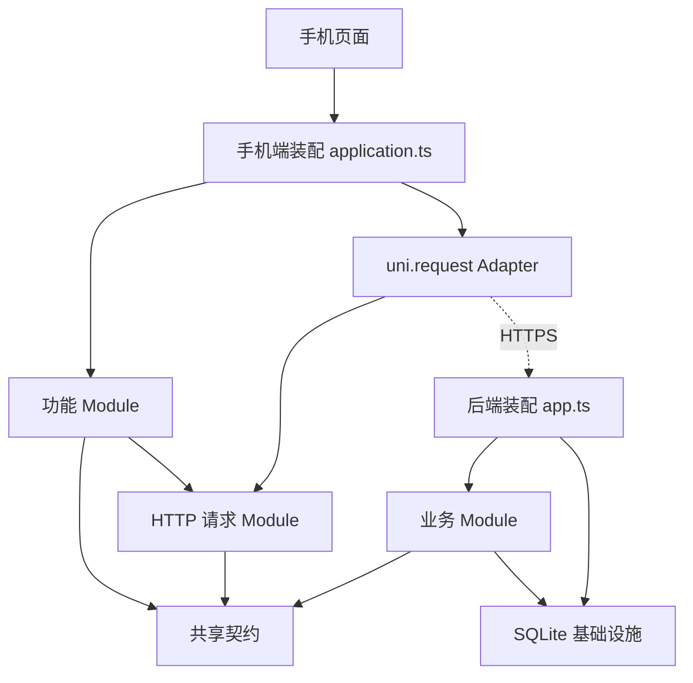

# 老板批了：架构设计

- 日期：2026-10-23
- 状态：架构规则与工程骨架已落地；业务能力按产品计划逐步实现。
- 需求依据：[核心产品需求](./核心产品需求.md)；选型与交付顺序：[技术方案与开发计划](./技术方案与开发计划.md)。
- 适用规模：按中型项目的可维护性组织代码，当前部署容量仍以两人使用、单实例为准。

## 1. 架构决策

采用模块化单体：一个手机应用、一个 Node.js 24 进程、一个服务端 SQLite 数据库。以业务 Module 组织实现，共享契约独立成 npm workspace。

| 选择 | 取舍 |
| --- | --- |
| 按业务组织 Module | 同一次业务变更集中修改，避免所有功能共享庞大的 controllers/services/repositories 目录 |
| 消费 Module 内管理预算、账本、审批和汇总 | 确认消费涉及同一事务，保持一致性与规则的 Locality |
| 共享类型、运行时校验和响应 Schema | 同一份 Interface 供手机端、后端和测试使用，减少协议漂移 |
| 只为真实变化设置 Seam | HTTP 传输有 uni.request 与测试 Adapter；SQLite 使用真实内存库测试，不预设通用仓储接口 |
| 当前直接用 SQL | 不增加 ORM、依赖注入容器、事件总线、微服务或通用基类；需求出现后再评估 |

这里的 Module 指具有 Interface 与 Implementation 的代码集合。Interface 包含类型、权限、不变量、错误、配置与生命周期；Seam 是 Interface 所在的位置。Depth 取决于调用者通过小 Interface 获得多少行为，而不是文件层数。消费 Module 隐藏事务和状态迁移，为调用者提供 Leverage，并把变更集中在同一个地方。

## 2. 结构与依赖方向



图中的实线表示代码依赖，虚线表示运行时通信。手机端和后端禁止互相导入源码，协议只通过 `@bossok/contracts` 共享。所有 Module 的跨模块调用通过 `index.ts` 提供的公开 Interface，不能直接访问另一个 Module 的内部 SQL 或文件。

### 当前已落地目录

```text
BossOK/
  package.json                 workspace、构建与检查入口
  tsconfig.base.json           共享严格类型设置
  tsconfig.test.json           跨工作区测试的类型检查
  packages/contracts/
    src/index.ts               共享响应类型、Schema、运行时校验
  app/src/
    application.ts             创建请求与功能 Module，连接具体 Adapter
    config.ts                  客户端环境配置与 H5 默认地址
    pages/                     页面、交互状态和导航
    features/health/index.ts   健康检查 Interface 与协议校验
    shared/http/index.ts       网络与 HTTP 错误处理、传输 Seam
    platform/uni-request.ts    uni.request Adapter 与超时
  server/src/
    index.ts                   进程启动、信号与监听
    config.ts                  环境校验、数据库路径解析
    app.ts                     装配入口，拥有数据库生命周期
    http/errors.ts             HTTP 错误响应策略
    modules/health/index.ts    健康检查路由 Module
    infrastructure/database/
      index.ts                 SQLite 打开、迁移、失败清理
  server/migrations/           顺序执行的 SQL，部署时保留
  server/tests/                后端行为、跨端契约、模块依赖规则测试
```

### 业务开发时再建立的目录

| 后端 Module | 所有权与 Interface 方向 |
| --- | --- |
| `identity` | 用户、会话、邀请码、绑定关系；提供身份解析和当前关系内的权限检查 |
| `spending` | 预算、分类口径、支出退款、超支申请和统计；对外提供业务操作与查询 |
| `notifications` | 应用内消息、收件人、投递状态；提供事务内写入消息和事务后投递 |

这些目录当前未创建。`spending` 内按需增加 `budget.ts`、`ledger.ts`、`approval.ts`、`summary.ts` 等实现文件；只有某项能力复杂后才拆子目录。路由 Schema 可在 Module 内单独成文件，纯规则和 SQL 按复杂度拆分，不要求每个功能机械创建三层。

依赖方向为 `spending → identity / notifications`，`identity`、`notifications` 不反向依赖 `spending`。身份解析后使用服务端生成的当前操作者上下文，消费 Module 在每个操作中检查角色和绑定关系。通知内容由调用者提供安全的事件摘要，通知 Module 不反查业务 Module。

手机端同样按功能增加 `features/identity`、`features/spending`、`features/notifications`。页面保留表单与展示状态；金额、权限与审批的最终判断由后端完成。只有多个页面实际复用状态时再提取 composable，无需现在引入全局状态库。

## 3. 现有 Module 的 Interface

| Module | 公开 Interface | 不变量与错误 |
| --- | --- | --- |
| 后端应用 | `buildApp({ databasePath, logger? })` | 返回 Fastify 实例；不监听端口；应用拥有新建连接，`close()` 等待请求结束后关闭数据库；初始化失败释放连接 |
| 配置 | `readConfig(env)` | 不读取全局环境；返回监听地址与数据库路径；端口、空地址不合法时启动前失败 |
| SQLite | `openDatabase(path)` | 返回真实 SQLite 连接，由调用者关闭；开启外键和 WAL；迁移一次且在事务中执行；失败关闭连接并抛错 |
| 健康检查 | `healthModule` | 由装配入口注入数据库并注册 `/api/health`；检查真实数据库；不创建或关闭连接 |
| 手机端 HTTP | `createHttpClient({ baseUrl, transport })` | 返回 GET 请求函数；只负责地址、HTTP 状态和错误，成功结果仍为 `unknown`；不自动重试 |
| 手机端健康检查 | `createHealthClient(request).check()` | 从 HTTP 获取未知数据并执行共享运行时校验；不关心 uni、构建环境或具体地址 |
| 传输 Adapter | `uniTransport(url)` | 10 秒超时，返回 HTTP 状态与未知数据，网络失败拒绝 Promise；不决定业务成功 |
| 契约 | `@bossok/contracts` 的导出 | 仅协议类型、Schema 和纯校验；无 Node、Vue、数据库、环境读取或副作用依赖 |

只有外部调用者需要的内容才导出。当前健康 Module 很小，不为追求层数再增加健康仓储或业务层；主要 Depth 位于 SQLite 初始化和 HTTP 错误处理。后续 Depth 的重点是消费操作背后的权限、事务和审批规则。

## 4. 请求与错误契约

健康检查保留原有成功响应：

```json
{"status":"ok","service":"bossok-api","database":"ok"}
```

响应类型、Fastify 响应 Schema 与客户端校验位于共享契约。TypeScript 类型不能替代外部输入校验；服务器请求参数继续使用 JSON Schema，客户端对网络返回执行运行时校验。

失败使用 HTTP 状态和统一错误响应，不把错误藏在 200 成功响应中：

```json
{"code":"NOT_FOUND","message":"请求的资源不存在","requestId":"req-1"}
```

- 当前已实现：404 `NOT_FOUND`，4xx 参数/格式错误 `INVALID_REQUEST`，内部异常 `INTERNAL_ERROR`。
- 内部异常对外返回通用消息，不暴露 SQL、路径或堆栈；服务端记录异常与请求标识。
- 客户端区分 `CONFIG_ERROR`、`NETWORK_ERROR`、`HTTP_ERROR`、`INVALID_RESPONSE`；服务端返回的合法错误保留 `code`、状态与 `requestId`。
- 后续身份与业务开发时，再增加实际需要的未登录、无权限和状态冲突错误，不能把所有业务失败按内部异常处理。
- 日志默认不记录请求体，配置对授权头与 Cookie 脱敏。业务日志也不得记录密码、会话令牌或完整财务明细。
- 当前 HTTP 请求 Module 只实现已有 GET 能力；新增写操作时再扩展 method/body、身份令牌和幂等标识，不提前留空实现。

成功响应直接使用具体 DTO。列表分页、写操作错误和幂等返回在对应功能开发时确定，不建立通用的层层包裹响应结构。

## 5. 数据与事务所有权

- SQLite 位于服务端本地持久化磁盘；相对数据库路径固定按 `server/` 解析，不受启动目录影响。默认开发路径不变，已有数据和 SQL 迁移不变。
- 迁移文件继续集中在 `server/migrations/`。已经应用的迁移不修改，后续结构变更增加新编号文件；初始化阶段保留现有用户表。
- 消费 Module 拥有预算、账目、申请与汇总查询；通知 Module 拥有消息表；其他 Module 不能自行修改不属于自己的表。
- 消费确认以一个同步 SQLite 事务完成：校验当前状态和操作者 → 条件更新申请 → 创建唯一关联账目 → 通过通知公开 Interface 写入消息。事务中不能 `await` 或调用远程推送。
- 通知 Module 使用同一个被注入的数据库连接执行同步写入，因此消息可参与调用方的事务。记录消息失败应使业务事务回滚；远程投递在提交后进行，失败保留状态并可重试。
- 数据库唯一约束与客户端请求标识防止重复创建；角色和关系检查必须随实际读写执行，不能只在页面隐藏操作。
- 测试直接使用真实 SQLite 内存库和临时文件，避免维护行为不一致的假数据库。
- 金额使用整数分；业务日期按 Asia/Shanghai，操作时间使用统一时间戳；汇总从账目计算，不额外维护一份累计余额。

消费相关内容目前为后续实现约束，不代表事务、幂等、身份或通知功能已经可用。

## 6. 产品规则与待定事项

当前仓库最新需求已取消每日记账确认。结余自动统计本月预算生效后已结束的日期；无记录日期按零支出，页面注明按已录入账目统计，补记和退款后重算。本次重构不改变这一规则。

以下问题保持待定，不通过架构代码替用户作决定：预算变更生效日期、未消费申请是否占用额度、申请有效期与跨日处理、解绑后的数据访问方式、目标手机的系统与签名分发方式。

## 7. 构建、配置与部署

- `npm workspaces` 管理 `packages/contracts`、`app`、`server`，使用一个锁文件，不从另一个工作区的 `src` 或 `dist` 路径直接导入。
- 契约包先编译生成 JS 和声明文件；根目录的开发、类型检查、测试和构建命令自动完成前置构建。修改契约后重跑 `npm run build:contracts` 并重启开发进程。
- 根目录提供统一测试命令，测试运行器保留在 `server` 工作区，使 Vitest 所需的 Vite 版本与手机编译器固定的 Vite 5 分开解析；测试集中在 `server/tests/`，不在手机构建时加载。
- 后端只有启动入口把 `process.env` 传给配置 Module。相对数据库路径在源码和构建产物运行时均指向相同的 `server/` 目录。
- 手机端环境在构建时注入，H5 默认 `/api` 走同源代理，手机填写实际可达地址。运行时不从共享契约读取环境配置。
- 生产部署保留 `server/dist`、`server/migrations`、`packages/contracts/dist` 和已安装的工作区依赖；不能只复制一个 `server/dist` 目录。默认监听本机，通过 HTTPS 反向代理对外提供访问。
- 一次只部署一个 Node 进程；SQLite 在线备份使用备份机制并验证恢复。进程退出先停止接收请求再释放数据库。
- App 资源构建与签名安装包仍是两步，鸿蒙和安卓分别验证。依赖风险沿用 README 中的已知记录，本次不进行框架大版本升级。

## 8. 检查与演进规则

根目录 `npm run check` 统一运行：

1. 工作区与测试代码类型检查。
2. Vitest 行为测试与模块依赖规则检查。
3. 契约、服务端和 H5 构建；手机资源另外运行 `npm run build:app`。

行为测试从 Module 的 Interface 穿过 Seam：后端通过 `inject` 和真实数据库验证，跨端测试把 Fastify inject 作为传输 Adapter，验证同一个客户端 Module 对实际响应的处理。网络失败、错误协议与配置错误使用可控的测试 Adapter。

依赖规则测试使用 TypeScript AST 检查源码的静态导入、重导出和字符串动态导入：禁止前后端互相依赖、禁止绕过契约包导出、限制基础设施反向依赖、要求跨功能 Module 经过 `index.ts`。它不是完整的安全扫描或循环依赖分析，未检查运行时计算路径；新增路径别名或加载方式时需同步维护规则。

后续每次新增功能先确定归属、公开 Interface、权限与事务不变量，再添加实现和行为测试。只有出现真实的第二种 Adapter、多个调用点或独立部署需求时才提取额外 Seam，不预设数据库替换或拆分进程。

## 9. 本次调整清单

已完成：共享契约 workspace、严格类型基础配置、根级测试入口、数据库基础设施目录、健康路由 Module、应用资源所有权、集中配置、统一错误响应、手机端功能与平台请求拆分、契约与依赖规则测试。

保持：五个页面路径、健康成功响应、数据库默认位置、现有迁移与数据、Node 24 及已确定的框架版本。

尚未实现：身份与绑定、预算、记账、审批、自动结余与通知。现有工程只是这些业务能力的架构起点。

验证记录（Node 24.22.1）：统一类型检查、5 个测试文件中的 20 项测试、服务端/H5 构建和 App 资源编译通过；构建后直接加载应用，验证了契约包解析、迁移文件定位和健康检查。未执行真机安装、生产部署或新一轮依赖漏洞审计。
